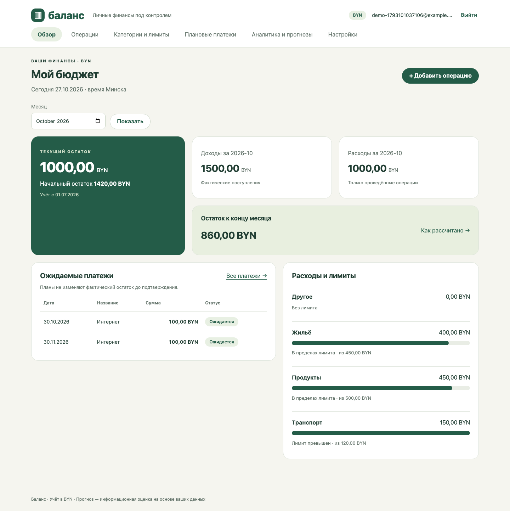
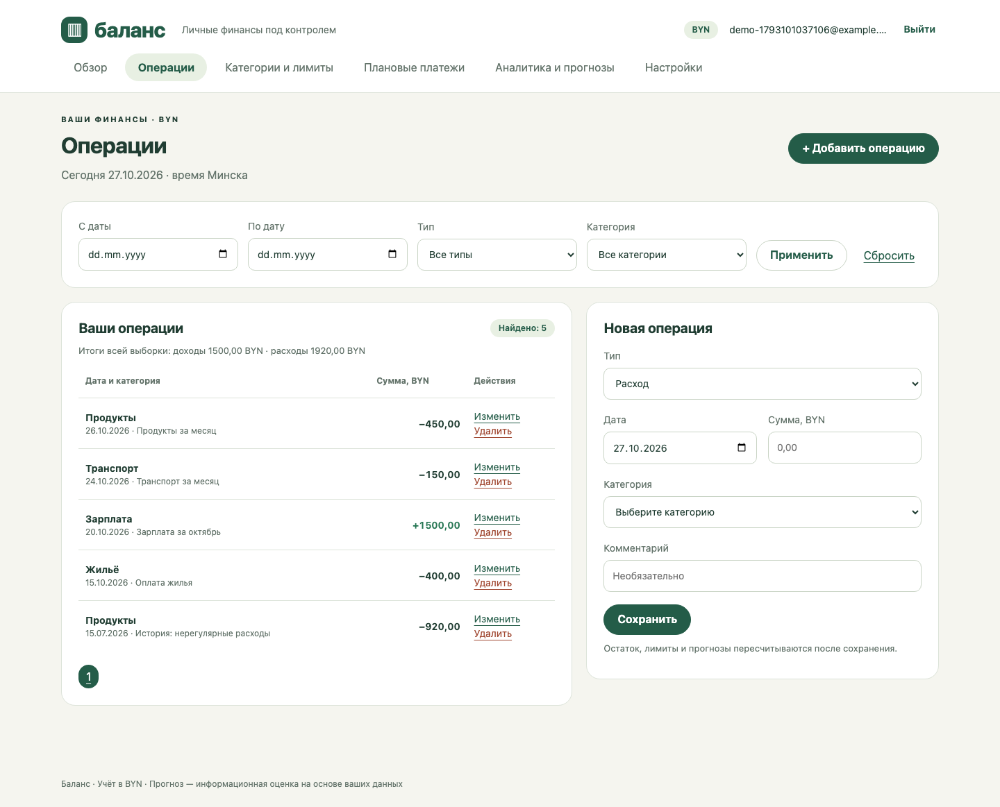
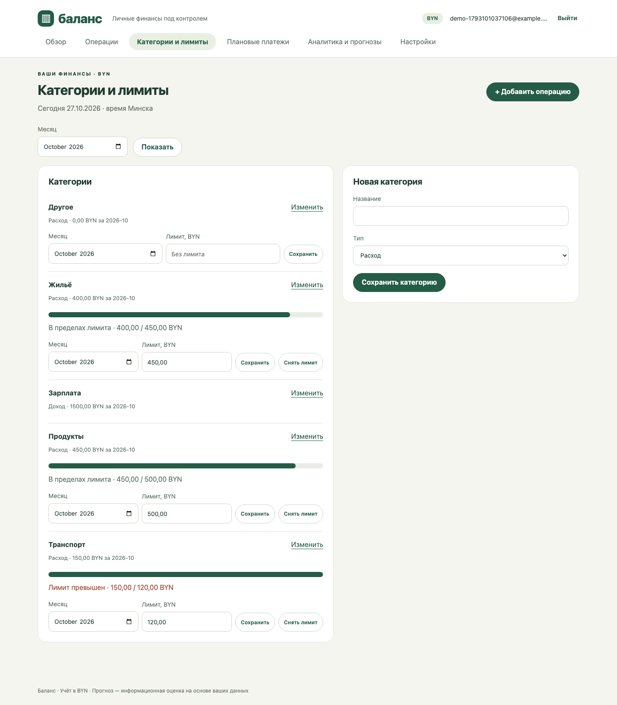
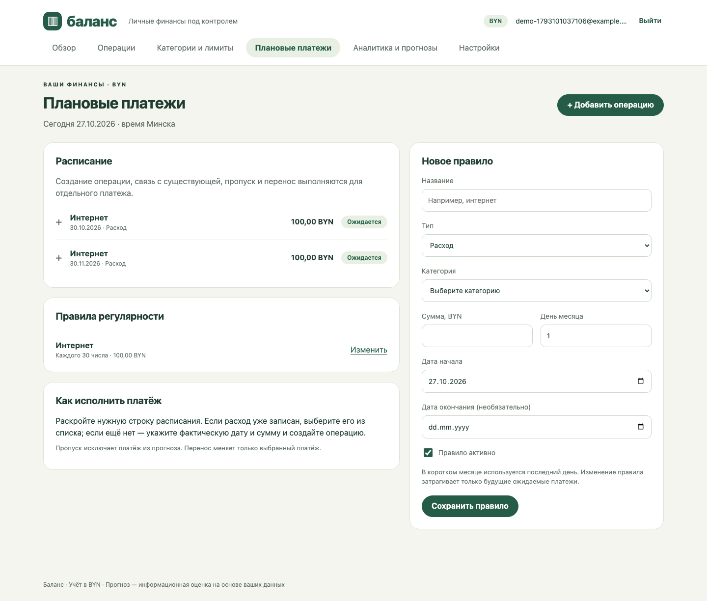
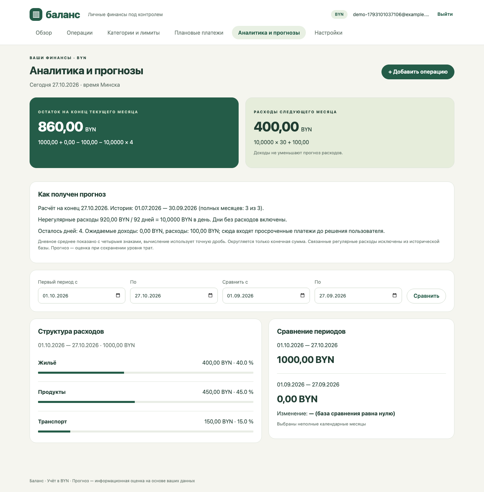

# Реализация «Баланса»

Дата: 27 октября 2026 года. Автор: Кузьменков Егор Валентинович, группа 450503.

Приложение реализует личный бюджет в BYN: регистрацию, вход, операции и фильтры, категории и лимиты, ежемесячные платежи, аналитику и два прогноза. Внешние финансовые сервисы не используются. Интерфейс продолжает светлый зелёный дизайн макетов раздела 3.5 отчёта.

## Устройство

| Часть | Файлы | Назначение |
|---|---|---|
| Запуск | cmd/balance/main.go | Конфигурация, HTTP/TLS, резервные копии, корректное завершение |
| Предметная область | internal/balance/model.go | Валидация, операции, лимиты, расписания, прогнозы |
| Хранилище | internal/balance/store.go | Файл JSON версии 1, блокировка процесса, атомарные транзакции |
| Учётные записи | internal/balance/auth.go | PBKDF2, ограничение попыток, сеансы |
| Веб-обработчики | internal/balance/server.go | Маршрутизация, CSRF, проверка владельца, подготовка представлений |
| Интерфейс | internal/balance/web/ | Встроенные HTML-шаблоны, CSS и небольшой необязательный JavaScript |

Go 1.26, только стандартная библиотека. Сервер формирует HTML через html/template с контекстным экранированием. Данные отправляются обычными формами POST, после успешного сохранения выполняется перенаправление. JavaScript ограничивает список категорий по типу операции и показывает ход отправки; проверки всегда выполняются на сервере. Ручной ввод и основные действия работают без JavaScript.

## Хранение и расчёты

Суммы — int64 в копейках, входная строка проверяется без float64. Среднее для прогнозов хранится как точная рациональная величина; округляется только итог, половина копейки — от нуля. Числа с плавающей точкой используются только для отображаемых процентов диаграмм и сравнения.

Каждое изменение выполняется над копией состояния под мьютексом. Файл сначала записывается во временный файл, синхронизируется и атомарно заменяет основной файл. Только затем публикуется новое состояние в памяти. Ошибка записи оставляет прежние данные и возвращает форму с введёнными значениями. После rename транзакция считается совершённой; синхронизация каталога выполняется дополнительно. Приложение предназначено для одного процесса на локальном диске macOS или Linux; flock исключает одновременный запуск второго сервера с тем же файлом. Для нескольких экземпляров потребуется заменить хранилище на транзакционную СУБД.

Ключ отправки формы сохраняется вместе с операцией; отдельная квитанция остаётся после удаления записи. Повтор одной формы, включая возврат кнопкой «Назад» после удаления, не создаёт вторую операцию. Связь планового вхождения и операции проверяется и сохраняется в той же транзакции. Одна операция может исполнить только одно вхождение. Удаление связанной операции возвращает платёж в ожидаемые.

Вхождения имеют стабильный ID «правило:год-месяц» и формируются до конца следующего месяца. День 31 в коротком месяце заменяется последним днём. Изменение правила обновляет только будущие ожидаемые вхождения; исполненные, пропущенные, просроченные и вручную перенесённые сохраняются. Изменение дня не добавляет новый платёж задним числом. Для операции в архивной категории разрешено исправить прежние данные, сохранив ту же категорию; новые операции в ней запрещены.

Оба прогноза используют до трёх полных завершённых месяцев учёта. Связанные регулярные расходы исключаются из базы. Ожидаемые просроченные платежи учитываются в текущем месяце, пока пользователь не исполнит, не пропустит или не перенесёт их. При отсутствии полного месяца числовые прогнозы не выводятся. Расчёт выполняется на конец текущего дня в Europe/Minsk. Поэтому пример 850 BYN относится к 26 октября с пятью оставшимися днями; 27 октября при тех же данных получится 860 BYN.

## Защита

- PBKDF2-HMAC-SHA256: 600000 итераций, индивидуальная случайная соль, ключ 32 байта; сравнение за постоянное время. Пароли 12–128 символов, в журналах отсутствуют.
- Пять ошибок входа в течение 15 минут блокируют учётную запись на 15 минут. Счётчики сохраняются на диске; неизвестный email получает то же сообщение и сравнимую работу хеширования.
- Случайные сеансы на сервере, завершение через 30 минут бездействия. Перезапуск аннулирует сеансы, но не бюджеты. Cookie HttpOnly и SameSite=Strict; Secure автоматически включается для встроенного TLS либо настройкой BALANCE_COOKIE_SECURE=true за HTTPS-прокси.
- Все формы изменения проверяют CSRF-токен; дополнительно применяется http.CrossOriginProtection. До входа используется отдельная случайная CSRF-cookie. Изменение данных через GET отсутствует.
- Каждый объект выбирается по ID и владельцу. Шаблоны экранируют пользовательский текст; CSP запрещает встроенные скрипты и внешние ресурсы. Тело формы ограничено 32 KiB.
- Ошибки записи и готовности связываются с X-Request-ID. Секреты, комментарии и финансовые записи в журнал не выводятся. Файлы данных и копий создаются с режимом 0600, каталоги — 0700.

## Маршруты

GET: /login, /register, /overview, /operations, /categories, /payments, /analytics, /settings, /healthz, /static/style.css, /static/app.js.

POST: /login, /register, /logout, /budget, /category, /limit, /operation, /operation/delete, /rule, /payment.

/healthz проверяет чтение корректного файла и возможность записи в каталог; сбой возвращает HTTP 503. Публичное JSON API в текущую версию не входит.

## Эксплуатация

```sh
go run ./cmd/balance
# Открыть http://127.0.0.1:8080, зарегистрироваться и настроить бюджет.
```

| Переменная | Значение по умолчанию | Назначение |
|---|---|---|
| BALANCE_ADDR | 127.0.0.1:8080 | Адрес прослушивания |
| BALANCE_DATA | data/balance.json | Файл данных |
| BALANCE_COOKIE_SECURE | false | Для локального HTTP; установить true за HTTPS-прокси |
| BALANCE_TLS_CERT | пусто | Файл TLS-сертификата |
| BALANCE_TLS_KEY | пусто | Файл TLS-ключа; задаётся вместе с сертификатом |

Для сетевого доступа используйте TLS или HTTPS-прокси и BALANCE_COOKIE_SECURE=true. Встроенный TLS включается при одновременном указании сертификата и ключа. HTTP по умолчанию доступен только на loopback.

```sh
# Сборка с идентификатором коммита
make build
./bin/balance

# Контейнер, порт опубликован только на loopback
docker compose up --build -d
# Остановка с сохранением тома
docker compose down
```

Первую копию сервер создаёт при запуске; затем раз в час проверяет необходимость новой суточной копии. Хранятся семь последних дат в каталоге рядом с данными: data/balance.json.backups/. Ежедневная копия фиксирует состояние начала периода; копии нужно дополнительно выносить на отдельный носитель. При первоначальном недоступном каталоге копий сервер завершает запуск с ошибкой; дальнейшие ошибки пишутся в журнал.

```sh
# Отдельная копия при остановленном сервере
BALANCE_DATA=data/balance.json go run ./cmd/balance -backup

# Сначала остановить сервер. При необходимости сохранить нынешний файл отдельно.
BALANCE_DATA=data/balance.json go run ./cmd/balance -restore data/balance.json.backups/2026-10-27.json
```

Восстановление проверяет JSON и версию формата и атомарно заменяет состояние под той же блокировкой. Локальный тест восстановления пройден; лимит 30 минут в контрольном окружении SRS отдельно не измерялся. Дата начала бюджета ограничена 01.01.2000 для ограничения глубины расписаний; эту дополнительную границу следует учесть при будущей редакции требований.

## Иллюстрации работающего приложения

Снимки сделаны браузерной проверкой на синтетическом бюджете. Макеты отчёта остаются проектными иллюстрациями; файлы ниже показывают реализацию.







[Мобильный вид](screenshots/mobile.png), [результаты проверок](testing.md), [проект замечаний заказчика](customer-review.md).
