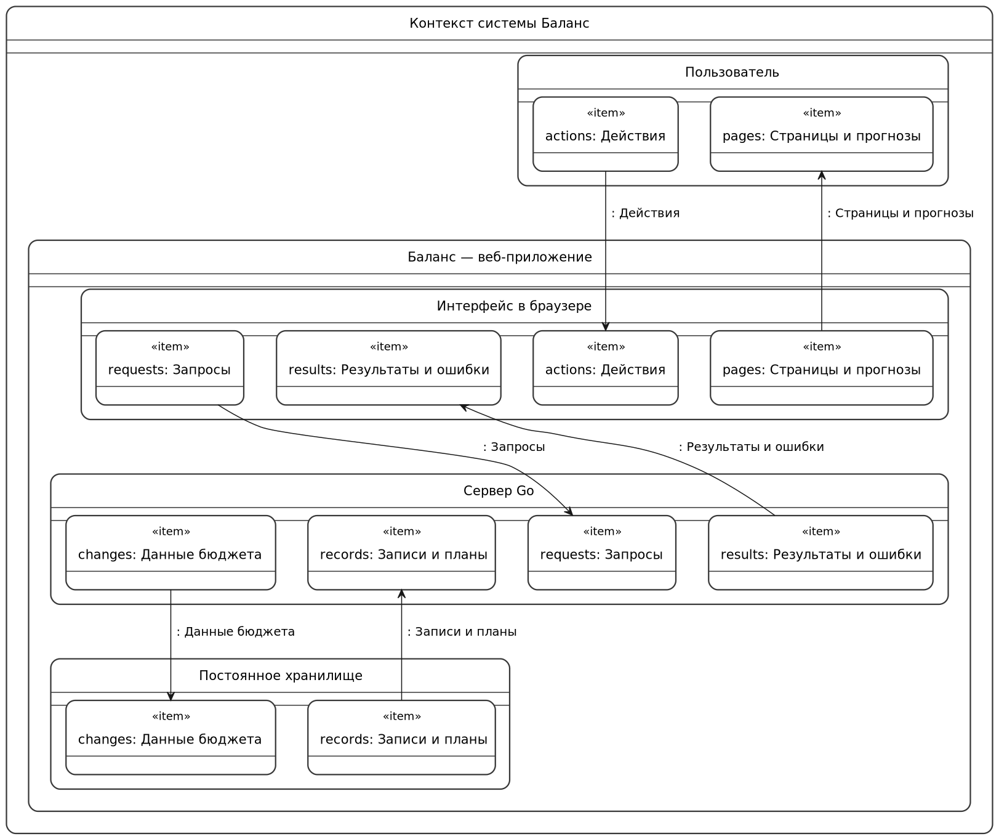
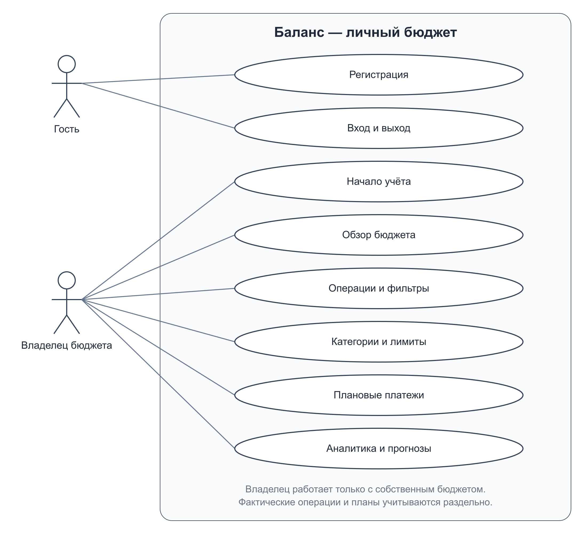
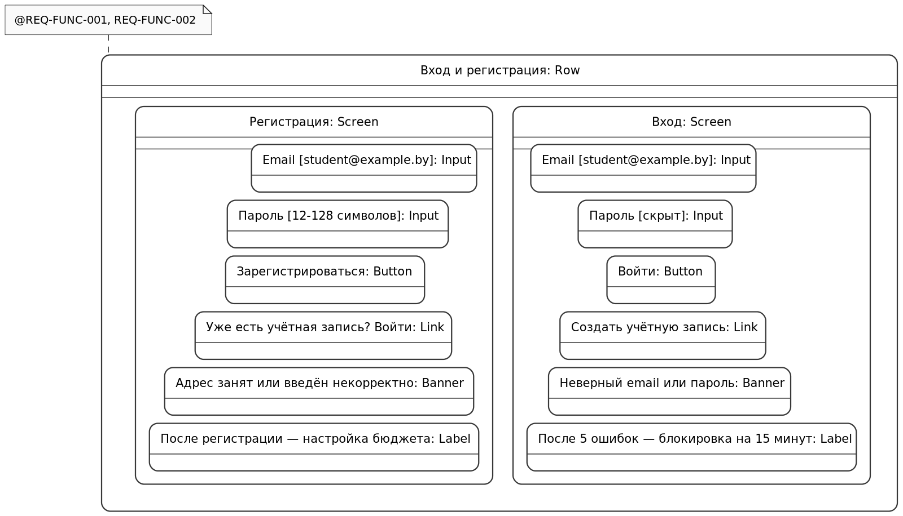
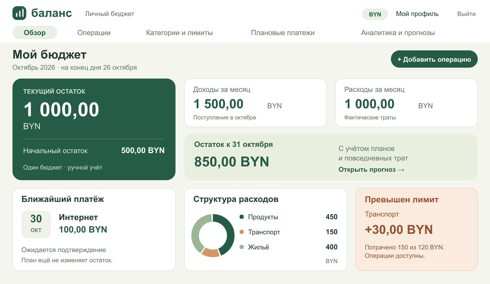
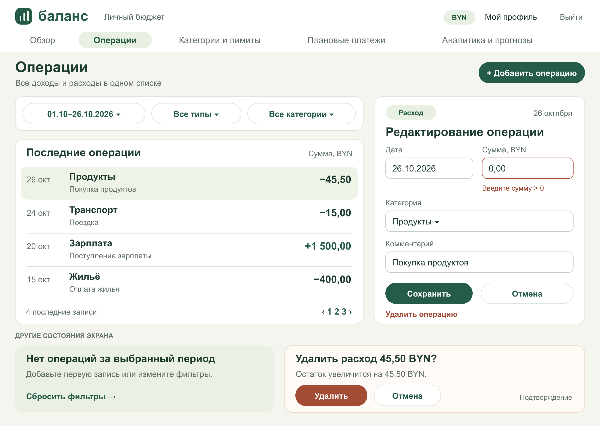
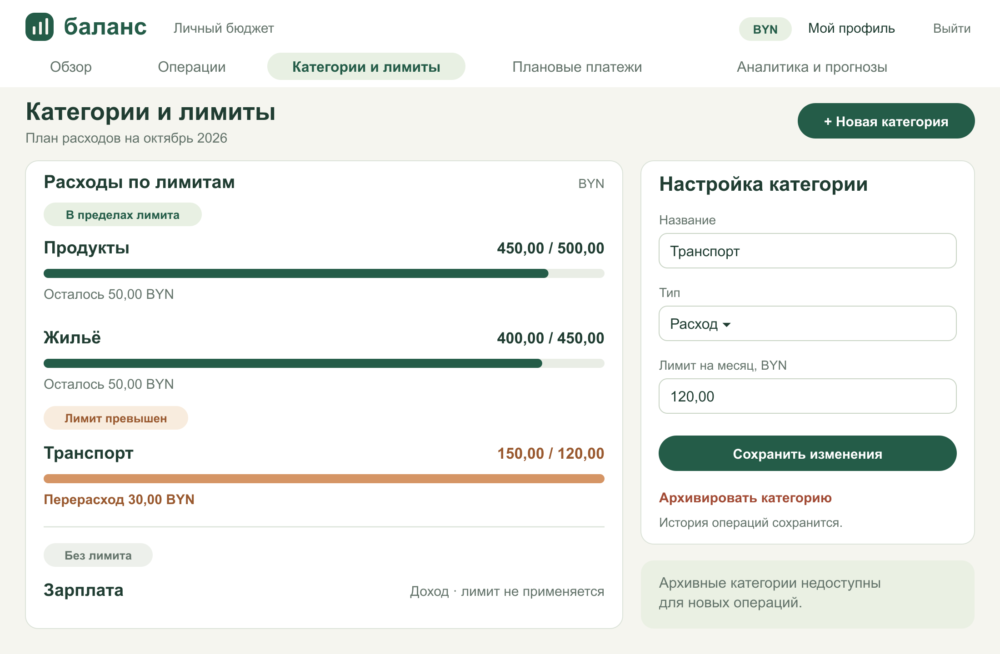
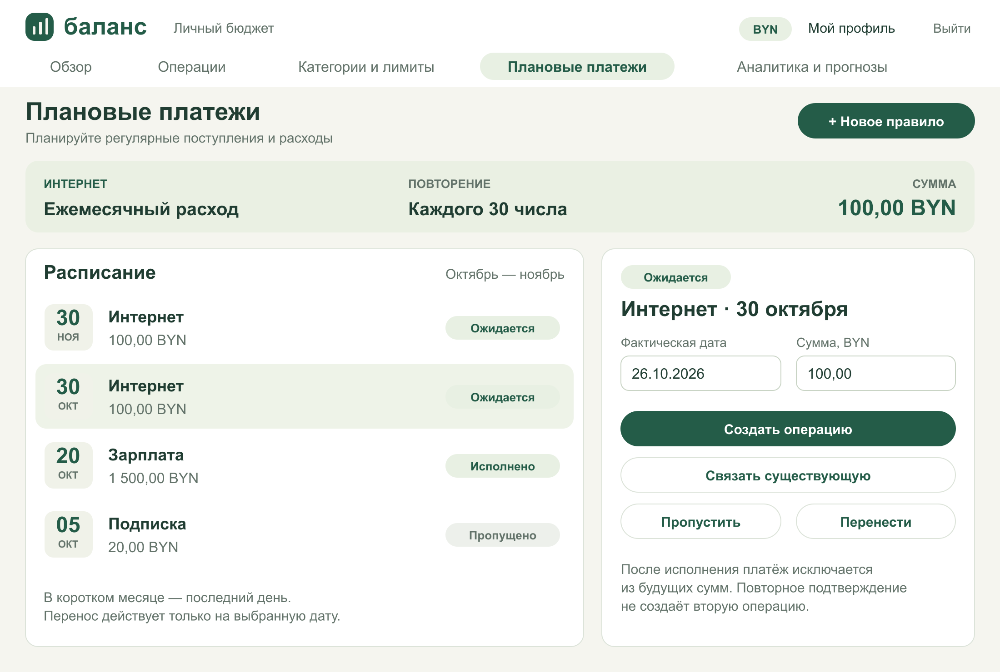
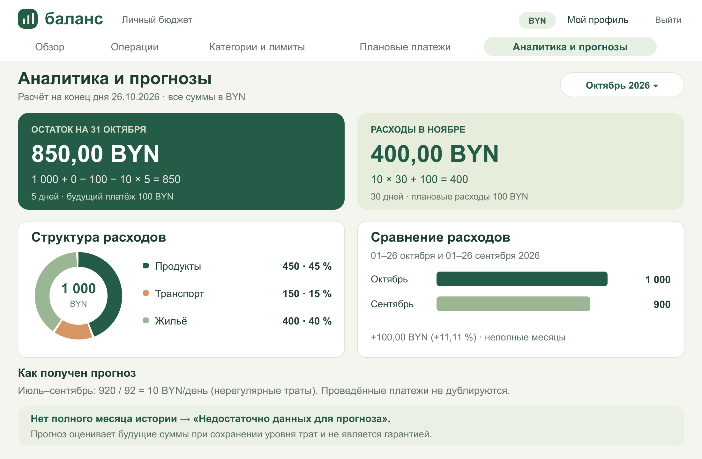

# Спецификация требований к ПО

Для проекта «Баланс — система анализа и прогнозирования личного бюджета»

Версия 0.5 · 27 октября 2026 года

Автор: Кузьменков Е. В., группа 450503, БГУИР, кафедра ЭВМ.
Заказчик в учебной паре: Новицкий Е. Ю.

## Оглавление

- [1. Введение](#1-введение)
  - [1.1 Назначение документа](#11-назначение-документа)
  - [1.2 Область применения продукта](#12-область-применения-продукта)
  - [1.3 Определения, акронимы и сокращения](#13-определения-акронимы-и-сокращения)
  - [1.4 Ссылки](#14-ссылки)
  - [1.5 Обзор документа](#15-обзор-документа)
- [2. Обзор продукта](#2-обзор-продукта)
  - [2.1 Перспектива продукта](#21-перспектива-продукта)
  - [2.2 Функции продукта](#22-функции-продукта)
  - [2.3 Ограничения продукта](#23-ограничения-продукта)
  - [2.4 Характеристики пользователей](#24-характеристики-пользователей)
  - [2.5 Допущения и зависимости](#25-допущения-и-зависимости)
  - [2.6 Распределение требований](#26-распределение-требований)
- [3. Требования](#3-требования)
  - [3.1 Внешние интерфейсы](#31-внешние-интерфейсы)
    - [3.1.1 Пользовательские интерфейсы](#311-пользовательские-интерфейсы)
    - [3.1.2 Аппаратные интерфейсы](#312-аппаратные-интерфейсы)
    - [3.1.3 Программные интерфейсы](#313-программные-интерфейсы)
  - [3.2 Функциональные требования](#32-функциональные-требования)
    - [3.2.1 Учётная запись](#321-учётная-запись)
    - [3.2.2 Бюджет и категории](#322-бюджет-и-категории)
    - [3.2.3 Операции и фильтры](#323-операции-и-фильтры)
    - [3.2.4 Обзор и аналитика](#324-обзор-и-аналитика)
    - [3.2.5 Лимиты категорий](#325-лимиты-категорий)
    - [3.2.6 Регулярные платежи](#326-регулярные-платежи)
    - [3.2.7 Прогнозирование](#327-прогнозирование)
    - [3.2.8 Правила расчёта](#328-правила-расчёта)
  - [3.3 Качество обслуживания](#33-качество-обслуживания)
    - [3.3.1 Производительность](#331-производительность)
    - [3.3.2 Безопасность](#332-безопасность)
    - [3.3.3 Надёжность](#333-надёжность)
    - [3.3.4 Доступность](#334-доступность)
    - [3.3.5 Наблюдаемость](#335-наблюдаемость)
  - [3.4 Соответствие стандартам](#34-соответствие-стандартам)
  - [3.5 Проектирование и реализация](#35-проектирование-и-реализация)
    - [3.5.1 Установка](#351-установка)
    - [3.5.2 Сборка и поставка](#352-сборка-и-поставка)
    - [3.5.3 Распределение](#353-распределение)
    - [3.5.4 Сопровождаемость](#354-сопровождаемость)
    - [3.5.5 Повторное использование](#355-повторное-использование)
    - [3.5.6 Переносимость](#356-переносимость)
    - [3.5.7 Стоимость](#357-стоимость)
    - [3.5.8 Сроки](#358-сроки)
    - [3.5.9 Доказательство концепции](#359-доказательство-концепции)
    - [3.5.10 Управление изменениями](#3510-управление-изменениями)
  - [3.6 ИИ и машинное обучение](#36-ии-и-машинное-обучение)
    - [3.6.1 Спецификация модели](#361-спецификация-модели)
    - [3.6.2 Управление данными](#362-управление-данными)
    - [3.6.3 Ограничители](#363-ограничители)
    - [3.6.4 Этика](#364-этика)
    - [3.6.5 Участие человека](#365-участие-человека)
    - [3.6.6 Жизненный цикл модели](#366-жизненный-цикл-модели)
- [4. Верификация](#4-верификация)
- [5. Приложения](#5-приложения)
  - [Приложение А. Графические материалы SysML v2](#приложение-а-графические-материалы-sysml-v2)
    - [А.1 Контекст системы](#а1-контекст-системы)
    - [А.2 Варианты использования](#а2-варианты-использования)
    - [А.3 Вход и регистрация](#а3-вход-и-регистрация)
    - [А.4 Обзор бюджета](#а4-обзор-бюджета)
    - [А.5 Операции](#а5-операции)
    - [А.6 Категории и лимиты](#а6-категории-и-лимиты)
    - [А.7 Плановые платежи](#а7-плановые-платежи)
    - [А.8 Аналитика и прогнозы](#а8-аналитика-и-прогнозы)
  - [Приложение Б. Словарь данных](#приложение-б-словарь-данных)
  - [Приложение В. Проверка расчётной концепции](#приложение-в-проверка-расчётной-концепции)
  - [Приложение Г. Трассировка бизнес-целей](#приложение-г-трассировка-бизнес-целей)
  - [Приложение Д. Открытые технические вопросы](#приложение-д-открытые-технические-вопросы)

## История изменений

| Версия | Дата | Автор | Изменение |
|---|---|---|---|
| 0.1 | 25.10.2026 | Кузьменков Е. В. | Исходные требования к первой версии продукта |
| 0.2 | 25.10.2026 | Кузьменков Е. В. | Уточнены REQ-FUNC-013 и 016, добавлен REQ-FUNC-018 |
| 0.3 | 25.10.2026 | Кузьменков Е. В. | Структура по образцу ЛР №3; графика непосредственно из SysML v2, словарь данных, расчётная концепция и трассировка целей |
| 0.4 | 25.10.2026 | Кузьменков Е. В. | Отчёт приведён к предоставленному DOCX-шаблону; добавлены UML-диаграммы, деревья требований и пять цветных макетов в его стиле. Обновлены ссылки. Все 37 ID, формулировки и критерии сохранены |
| 0.5 | 27.10.2026 | Кузьменков Е. В. | Добавлено приложение на Go; обновлены статусы верификации, решения по хранению и безопасности; добавлены проект замечаний Новицкого Е. Ю. и исправления. Все 37 ID и критерии сохранены |

## 1. Введение

### 1.1 Назначение документа

SRS определяет поведение и ограничения первой версии «Баланса». Документ используется заказчиком для согласования сценариев, разработчиком для проектирования и проверяющим для приёмки. Отчёт ЛР №3 фиксирует этап требований. В текущую редакцию добавлены ссылки на реализацию приложения и фактические результаты её проверки.

### 1.2 Область применения продукта

«Баланс» помогает студенту или молодому специалисту вести единый личный бюджет: записывать доходы и расходы, контролировать категории и лимиты, учитывать регулярные платежи и оценивать будущие расходы. В версии 1.0 используются BYN, ручной ввод и один владелец бюджета. Несколько счетов, банковские подключения, валютный обмен, семейный доступ и машинное обучение в версию не входят.

### 1.3 Определения, акронимы и сокращения

| Термин | Определение |
|---|---|
| Операция | Подтверждённый фактический доход или расход |
| Плановое вхождение | Один ожидаемый доход или расход, созданный правилом регулярности |
| Нерегулярный расход | Фактический расход, не связанный с плановым вхождением |
| Полный месяц учёта | Завершённый календарный месяц, первый день которого не раньше даты начала учёта |
| Текущий остаток | Начальный остаток плюс фактические доходы минус фактические расходы |
| SRS | Спецификация требований к программному обеспечению |
| MoSCoW | Приоритеты Must, Should, Could, Won’t |

### 1.4 Ссылки

1. Лабораторная работа № 3 «Разработка и документирование бизнес-требований», БГУИР, кафедра ЭВМ; предоставленная методичка, 3 страницы. Обязательный учебный источник.
2. [Кафедральный шаблон SRS](srs-template.md). Обязательная структура документа.
3. [OMG SysML v2](https://www.omg.org/spec/SysML/2.0/). Справочный источник по моделированию.
4. [Официальные примеры SysML v2](https://github.com/Systems-Modeling/SysML-v2-Release). Справочный источник по нотации.
5. [PR-образец ЛР №3](https://github.com/kiryshabutor/SDLC/pull/1). Образец структуры документа и построения графики из SysML v2.

### 1.5 Обзор документа

Раздел 2 задаёт контекст, цели и ограничения. Раздел 3 содержит проверяемые требования и правила расчёта. Раздел 4 задаёт методы и сценарии проверки. Раздел 5 связывает спецификацию с моделью и изображениями.

## 2. Обзор продукта

### 2.1 Перспектива продукта

Продукт создаётся как самостоятельное веб-приложение. Пользователь работает со своим бюджетом через браузер; сервер обрабатывает запросы и хранит данные постоянно. Банки, платёжные системы и внешние финансовые API не участвуют в сценариях первой версии.

[Контекстная диаграмма](images/context.png) показывает пользователя, интерфейс, сервер Go и постоянное хранилище. Названия компонентов определяют концептуальные границы; выбор СУБД и фреймворка относится к последующему проектированию.

### 2.2 Функции продукта

Бизнес-цели являются целями приёмки будущего продукта, а не достигнутыми результатами лабораторной.

| Цель | Польза | Проверяемый критерий |
|---|---|---|
| БЦ-1 | Упростить ежедневную запись расходов | После знакомства с интерфейсом пользователь вводит каждую из пяти типовых операций не более чем за 45 секунд |
| БЦ-2 | Сделать перерасход заметным | Каждая категория с фактическими расходами выше лимита выделена при следующем открытии экрана бюджета |
| БЦ-3 | Сделать прогноз проверяемым | Для каждого показанного прогноза доступны период истории, формула и суммы; контрольные примеры воспроизводятся до копейки |

Основные функции: доступ к бюджету, операции и категории, обзор и аналитика, лимиты, регулярные платежи, два прогноза. Связи функций с требованиями показаны в [модели](sysml/balance.sysml).

### 2.3 Ограничения продукта

Обязательны Go для серверной логики, веб-интерфейс на русском языке, BYN и ручной ввод. Учебный набор данных вымышленный. Приоритет Must означает включение в первую реализуемую версию; модель на стадии требований не задаёт СУБД или веб-фреймворк.

### 2.4 Характеристики пользователей

Основная роль — владелец личного бюджета, студент или молодой специалист, знакомый с браузером. У каждого владельца отдельные данные. Администратор эксплуатации отвечает за запуск и резервные копии, но отдельный пользовательский кабинет администратора в объём не входит.

### 2.5 Допущения и зависимости

Пользователь записывает все существенные операции с даты начала учёта; система не может обнаружить пропущенный наличный расход. Прогноз предполагает сохранение среднего уровня нерегулярных трат и выполнение плановых платежей. Учётные даты и календарные расчёты используют Europe/Minsk. Текущий день не экстраполируется: пользователь завершает его ввод перед чтением прогноза, что отражено в пояснении интерфейса.

Риски: неполные записи и изменение привычек снижают полезность прогноза; короткая история обозначается явно. При отсутствии полного месяца числовая оценка не строится. Сервер, хранилище и браузер — единственные обязательные эксплуатационные зависимости.

### 2.6 Распределение требований

| Итерация будущей разработки | Возможности |
|---|---|
| 1 | Регистрация, вход, начальный остаток, категории, операции, изоляция и сохранность данных |
| 2 | Обзор, аналитика, лимиты, регулярные платежи и подтверждение исполнения |
| 3 | Оба прогноза, пояснения, граничные случаи и комплексная приёмка |

Все перечисленные требования относятся к версии продукта 1.0. Версии 0.1–0.4 обозначают редакции SRS, а не версии работающего приложения.

## 3. Требования

Каждое требование имеет неизменяемый ID, приоритет, критерии приёмки и метод проверки. Статус реализации всех требований — «Запланировано». Связи satisfy в модели задают проектное назначение функций; они не доказывают успешное выполнение тестов.

### 3.1 Внешние интерфейсы

#### 3.1.1 Пользовательские интерфейсы

Шесть моделей экранов: вход и регистрация, обзор бюджета, операции, категории и лимиты, плановые платежи, аналитика и прогноз. Все макеты описаны на SysML v2 и представлены в PNG в Приложении А. Переходы обозначены элементами Link и Button; состояния показаны элементами Banner.

#### REQ-INT-001 Адаптивный интерфейс

**Приоритет:** Must. **Статус:** Частично проверено.

**Формулировка:** Интерфейс должен поддерживать ширину окна от 360 до 1440 пикселей.

**Обоснование:** Использование телефона и компьютера.

**Критерии приёмки:**
- Основные действия доступны на ширинах 360, 768 и 1440 px; текст и формы не перекрываются.
- У полей есть подписи, ошибки представлены текстом; управление формами доступно с клавиатуры.

**Метод верификации:** Демонстрация. [Сценарий V-INT-001](verification/scenarios.md).

#### REQ-INT-002 Состояния экранов

**Приоритет:** Must. **Статус:** Частично проверено.

**Формулировка:** Интерфейс должен различать загрузку, отсутствие данных, ошибку ввода и ошибку сохранения.

**Обоснование:** Пользователь понимает результат действий.

**Критерии приёмки:**
- При ошибке сохранения введённые значения остаются в форме.
- Нет истории → объяснение без числового прогноза; нет операций → приглашение добавить первую.

**Метод верификации:** Демонстрация. [Сценарий V-INT-002](verification/scenarios.md).

#### REQ-INT-003 Веб-доступ

**Приоритет:** Must. **Статус:** Частично проверено.

**Формулировка:** Система должна предоставлять русскоязычный веб-интерфейс через HTTPS при сетевом развёртывании.

**Обоснование:** Доступ из браузера.

**Критерии приёмки:**
- Основные сценарии проходят в актуальных стабильных Chrome и Firefox, версии фиксируются в протоколе проверки.
- Денежные значения отображаются в BYN с двумя знаками после запятой; даты — день.месяц.год.

**Метод верификации:** Демонстрация. [Сценарий V-INT-003](verification/scenarios.md).

#### 3.1.2 Аппаратные интерфейсы

Специальные устройства не требуются. Ввод выполняется клавиатурой, мышью или сенсорным экраном через браузер.

#### 3.1.3 Программные интерфейсы

Браузер взаимодействует с сервером по HTTP(S). Перечень публичных API, формат сообщений и конкретная СУБД определяются при проектировании. Интеграции с банками, почтовыми провайдерами и платёжными сервисами отсутствуют. Для сетевого развёртывания обязателен HTTPS.

### 3.2 Функциональные требования

#### 3.2.1 Учётная запись

#### REQ-FUNC-001 Регистрация

**Приоритет:** Must. **Статус:** Реализовано; тесты пройдены.

**Формулировка:** Система должна создавать учётную запись по уникальному адресу электронной почты и паролю.

**Обоснование:** Разделение личных бюджетов пользователей.

**Критерии приёмки:**
- Корректный адрес и пароль длиной 12–128 символов создают одну запись.
- Повторный адрес и некорректные значения отклоняются; бюджет другого пользователя не изменяется.

**Метод верификации:** Тест. [Сценарий V-FUNC-001](verification/scenarios.md).

#### REQ-FUNC-002 Вход и выход

**Приоритет:** Must. **Статус:** Реализовано; тесты пройдены.

**Формулировка:** Система должна предоставлять вход по адресу и паролю и завершать текущий сеанс при выходе.

**Обоснование:** Повторный доступ к сохранённым данным.

**Критерии приёмки:**
- Верные данные открывают обзор; неверные дают общее сообщение без уточнения существования адреса.
- После выхода защищённая страница требует входа.

**Метод верификации:** Тест. [Сценарий V-FUNC-002](verification/scenarios.md).

#### 3.2.2 Бюджет и категории

#### REQ-FUNC-003 Начало учёта

**Приоритет:** Must. **Статус:** Частично проверено.

**Формулировка:** Система должна хранить для пользователя единый бюджет в BYN, дату начала учёта и начальный остаток.

**Обоснование:** Получение проверяемого текущего остатка.

**Критерии приёмки:**
- Дата начала не позже текущей даты; остаток задаётся с точностью до копейки и может быть отрицательным.
- Начальный остаток относится к началу выбранного дня, не считается доходом; операции до этой даты запрещены.
- После первой операции дата начала фиксируется; исправление начального остатка пересчитывает показатели после подтверждения.

**Метод верификации:** Тест. [Сценарий V-FUNC-003](verification/scenarios.md).

#### REQ-FUNC-004 Категории

**Приоритет:** Must. **Статус:** Реализовано; тесты пройдены.

**Формулировка:** Система должна позволять создавать, переименовывать и архивировать категории доходов и расходов.

**Обоснование:** Группировка операций по назначению.

**Критерии приёмки:**
- Название содержит 1–50 символов; одинаковые имена одного типа в одном бюджете отклоняются.
- Архивная категория остаётся у старых операций и в аналитике, но недоступна для новых.
- Тип категории соответствует типу операции.

**Метод верификации:** Тест. [Сценарий V-FUNC-004](verification/scenarios.md).

#### 3.2.3 Операции и фильтры

#### REQ-FUNC-005 Добавление операции

**Приоритет:** Must. **Статус:** Реализовано; тесты пройдены.

**Формулировка:** Система должна сохранять доход или расход с суммой, датой, категорией и необязательным комментарием.

**Обоснование:** Ручная фиксация фактического движения денег.

**Критерии приёмки:**
- Сумма 0,01–999999999,99 BYN; дата от начала учёта до текущего дня включительно; комментарий до 250 символов.
- Нулевая и отрицательная сумма, лишние десятичные знаки и пропущенные поля отклоняются с объяснением.
- Доход увеличивает остаток, расход уменьшает; повторная отправка одной формы не создаёт вторую операцию.

**Метод верификации:** Тест. [Сценарий V-FUNC-005](verification/scenarios.md).

#### REQ-FUNC-006 Изменение операции

**Приоритет:** Must. **Статус:** Реализовано; тесты пройдены.

**Формулировка:** Система должна позволять изменять собственную операцию с пересчётом остатка, лимитов, аналитики и прогнозов.

**Обоснование:** Исправление ошибок ввода.

**Критерии приёмки:**
- Изменение расхода 20,00 на 25,00 уменьшает остаток на 5,00 BYN.
- Смена даты или категории переносит сумму между соответствующими периодами и группами.
- При некорректном изменении сохраняются прежние значения.

**Метод верификации:** Тест. [Сценарий V-FUNC-006](verification/scenarios.md).

#### REQ-FUNC-007 Удаление операции

**Приоритет:** Must. **Статус:** Реализовано; тесты пройдены.

**Формулировка:** Система должна удалять выбранную собственную операцию только после подтверждения.

**Обоснование:** Удаление ошибочных записей.

**Критерии приёмки:**
- Отмена подтверждения оставляет запись и показатели без изменений.
- Удаление расхода 20,00 увеличивает остаток на 20,00 BYN.
- Для связанного планового платежа отменяется отметка исполнения, и он вновь требует решения пользователя.

**Метод верификации:** Тест. [Сценарий V-FUNC-007](verification/scenarios.md).

#### REQ-FUNC-008 Поиск и фильтры

**Приоритет:** Must. **Статус:** Реализовано; тесты пройдены.

**Формулировка:** Система должна фильтровать операции по включительным границам дат, типу и категории.

**Обоснование:** Поиск нужных записей.

**Критерии приёмки:**
- Комбинация фильтров применяется одновременно; период с началом после конца отклоняется.
- Пустая выборка показывает понятное сообщение; суммы вычисляются по всей выборке, а не только по странице.
- Список выводится по дате убыванию и времени создания убыванию, по 20 записей на страницу.

**Метод верификации:** Тест. [Сценарий V-FUNC-008](verification/scenarios.md).

#### 3.2.4 Обзор и аналитика

#### REQ-FUNC-009 Обзор бюджета

**Приоритет:** Must. **Статус:** Реализовано; тесты пройдены.

**Формулировка:** Система должна показывать текущий остаток, фактические доходы и расходы выбранного месяца и ближайшие плановые платежи.

**Обоснование:** Быстрая оценка состояния бюджета.

**Критерии приёмки:**
- Остаток равен начальному остатку плюс все фактические доходы минус расходы со дня начала учёта.
- Плановые платежи до подтверждения не меняют фактический остаток.
- Отрицательный остаток отображается со знаком минус и предупреждением.

**Метод верификации:** Тест. [Сценарий V-FUNC-009](verification/scenarios.md).

#### REQ-FUNC-010 Аналитика расходов

**Приоритет:** Must. **Статус:** Реализовано; тесты пройдены.

**Формулировка:** Система должна показывать суммы и доли расходов по категориям и сравнивать два выбранных периода.

**Обоснование:** Выявление крупных статей расходов.

**Критерии приёмки:**
- Суммы диаграммы совпадают с итогом фактических расходов за период.
- При нулевом итоге доли не рассчитываются; при нулевой базе сравнения процент изменения заменяется прочерком.
- Периоды сравнения указаны явно; неполный месяц обозначается как неполный.

**Метод верификации:** Тест. [Сценарий V-FUNC-010](verification/scenarios.md).

#### 3.2.5 Лимиты категорий

#### REQ-FUNC-011 Лимиты категорий

**Приоритет:** Must. **Статус:** Реализовано; тесты пройдены.

**Формулировка:** Система должна хранить месячные лимиты расходов по категориям и показывать их использование.

**Обоснование:** Раннее обнаружение перерасхода.

**Критерии приёмки:**
- Для пары месяц–категория существует не более одного положительного лимита.
- При расходе больше лимита выводится предупреждение; при равенстве — «Лимит достигнут».
- Расход не блокируется; изменение и удаление операции обновляют использование лимита.

**Метод верификации:** Тест. [Сценарий V-FUNC-011](verification/scenarios.md).

#### 3.2.6 Регулярные платежи

#### REQ-FUNC-012 Регулярные платежи

**Приоритет:** Must. **Статус:** Реализовано; тесты пройдены.

**Формулировка:** Система должна формировать ежемесячные плановые доходы и расходы по заданному пользователем расписанию.

**Обоснование:** Учёт будущей зарплаты и обязательных платежей.

**Критерии приёмки:**
- Правило задаёт тип, сумму, категорию, день 1–31, дату начала и необязательную дату окончания.
- Для короткого месяца используется его последний день; каждое вхождение имеет собственный статус.
- Изменение правила влияет только на ещё не наступившие неисполненные вхождения; проведённые операции сохраняются.

**Метод верификации:** Тест. [Сценарий V-FUNC-012](verification/scenarios.md).

#### REQ-FUNC-013 Исполнение платежа

**Приоритет:** Must. **Статус:** Реализовано; тесты пройдены.

**Формулировка:** Система должна связывать плановое вхождение с одной фактической операцией при подтверждении исполнения.

**Обоснование:** Исключение двойного учёта.

**Критерии приёмки:**
- Можно создать операцию с фактической суммой и датой либо связать существующую собственную операцию того же типа.
- Одно вхождение связано не более чем с одной операцией, одна операция — не более чем с одним вхождением.
- Исполненное вхождение исключается из будущих сумм; связанный расход исключается из базы нерегулярных расходов.

**Метод верификации:** Тест. [Сценарий V-FUNC-013](verification/scenarios.md).

#### REQ-FUNC-018 Просроченный плановый платёж

**Приоритет:** Must. **Статус:** Реализовано; тесты пройдены.

**Формулировка:** Система должна показывать неисполненное вхождение с прошедшей датой как просроченное и требовать решения пользователя.

**Обоснование:** Предотвращение исчезновения обязательств из расчёта.

**Критерии приёмки:**
- Просроченное вхождение остаётся в ожидаемых суммах текущего месяца до исполнения, пропуска или переноса.
- Пропуск исключает его из прогноза и сохраняет статус; перенос меняет дату этого вхождения.
- Просроченный платёж не считается фактическим расходом автоматически.

**Метод верификации:** Тест. [Сценарий V-FUNC-018](verification/scenarios.md).

#### 3.2.7 Прогнозирование

#### REQ-FUNC-014 Прогноз остатка

**Приоритет:** Must. **Статус:** Реализовано; тесты пройдены.

**Формулировка:** Система должна оценивать остаток на конец текущего месяца по правилам F1–F4 раздела 3.2.8.

**Обоснование:** Оценка возможного дефицита до конца месяца.

**Критерии приёмки:**
- Применяются текущий остаток, ожидаемые доходы, расходы и среднесуточные нерегулярные траты.
- При B=1000, I=0, P=100, a=10 и D=5 результат равен 850,00 BYN.
- Отрицательная оценка сопровождается предупреждением о возможном дефиците.

**Метод верификации:** Тест. [Сценарий V-FUNC-014](verification/scenarios.md).

#### REQ-FUNC-015 Прогноз расходов

**Приоритет:** Must. **Статус:** Реализовано; тесты пройдены.

**Формулировка:** Система должна оценивать расходы следующего календарного месяца по правилу F5.

**Обоснование:** Планирование месячной нагрузки.

**Критерии приёмки:**
- Результат равен среднесуточным нерегулярным тратам, умноженным на число дней месяца, плюс плановые расходы этого месяца.
- При a=10, N=30 и Pnext=100 результат равен 400,00 BYN.
- Плановые доходы не вычитаются из показателя расходов.

**Метод верификации:** Тест. [Сценарий V-FUNC-015](verification/scenarios.md).

#### REQ-FUNC-016 История для прогноза

**Приоритет:** Must. **Статус:** Реализовано; тесты пройдены.

**Формулировка:** Система должна выбирать до трёх последних полных календарных месяцев учёта перед текущим месяцем.

**Обоснование:** Сопоставимость исходных данных.

**Критерии приёмки:**
- Месяц считается полным, если его первый день не раньше даты начала учёта и он уже завершён.
- При одном или двух полных месяцах используются они; при нуле числовой прогноз не показывается.
- Дни без расходов включаются в знаменатель; из числителя исключены расходы, связанные с регулярными платежами.

**Метод верификации:** Тест. [Сценарий V-FUNC-016](verification/scenarios.md).

#### REQ-FUNC-017 Объяснение прогноза

**Приоритет:** Must. **Статус:** Реализовано; тесты пройдены.

**Формулировка:** Система должна показывать дату расчёта, период истории, формулу и исходные суммы каждого прогноза.

**Обоснование:** Возможность проверить оценку.

**Критерии приёмки:**
- Отображаются a, число оставшихся дней, плановые суммы и дата окончания текущего дня учёта.
- Прогноз обозначен как оценка при сохранении привычного уровня трат.
- При неполной истории явно указано число используемых месяцев; при отсутствии истории показана причина.

**Метод верификации:** Тест. [Сценарий V-FUNC-017](verification/scenarios.md).

#### 3.2.8 Правила расчёта

F1. Пусть H — от одного до трёх последних полных календарных месяцев учёта, E — сумма нерегулярных расходов в них, L — суммарное число календарных дней H. Среднесуточные траты: `a = E / L`. Нулевые дни включены в L. Промежуточное a не округляется; итог округляется до копейки по правилу половины вверх.

F2. Текущий фактический остаток: `B = B0 + Σ доходов − Σ расходов` с даты начала учёта. Плановые суммы в B не входят.

F3. D — число дней после текущего дня до конца месяца. В последний день D = 0. Оценка предполагает, что операции текущего дня внесены полностью.

F4. Прогноз остатка: `Bend = B + Iremaining − Premaining − a × D`. В Iremaining и Premaining входят неисполненные вхождения со сроком до конца текущего месяца, включая просроченные. Исполненные и пропущенные вхождения исключены. Перенесённые учитываются по новой дате.

F5. Прогноз расходов следующего месяца: `Enext = a × Nnext + Pnext`, где Nnext — календарные дни следующего месяца, Pnext — его неисполненные плановые расходы. Просроченные платежи включаются в Pnext только после явного переноса на следующий месяц; иначе они уже входят в Premaining.

F6. Связанный с плановым платежом фактический расход участвует в B и аналитике факта, но исключён из E. Исполнение переводит ожидаемую сумму в фактическую; повторное исполнение того же вхождения запрещено. Удаление связанной операции отменяет исполнение вхождения.

F7. Отсутствие H означает отсутствие обоих числовых прогнозов. Ноль расходов при существующем H является допустимым входом: a = 0. Отсутствующие плановые доходы не угадываются из прошлых поступлений.

Пример: на конец 26.10.2026 B = 1000 BYN, история за июль–сентябрь содержит E = 920 BYN за L = 92 дня, поэтому a = 10 BYN/день. D = 5, Iremaining = 0, Premaining = 100 BYN: Bend = 850 BYN. Для ноября Nnext = 30 и Pnext = 100 BYN: Enext = 400 BYN.

### 3.3 Качество обслуживания

#### 3.3.1 Производительность

#### REQ-PERF-001 Отклик списков

**Приоритет:** Must. **Статус:** Реализовано; тесты пройдены.

**Формулировка:** Система должна отвечать на запрос списка операций не более чем за 2 секунды для 95 процентов запросов в контрольном окружении.

**Обоснование:** Работа с накопленной историей.

**Критерии приёмки:**
- Контроль: сервер 2 vCPU, 2 ГБ RAM; 10 одновременных пользователей; по 10000 операций; 1000 запросов после прогрева.
- Измеряется серверное время ответа; условия и фактическое значение p95 записываются в протокол.

**Метод верификации:** Тест. [Сценарий V-PERF-001](verification/scenarios.md).

#### REQ-PERF-002 Расчёт прогноза

**Приоритет:** Must. **Статус:** Реализовано; тесты пройдены.

**Формулировка:** Система должна рассчитывать оба прогноза не более чем за 1 секунду для 95 процентов запросов в контрольном окружении REQ-PERF-001.

**Обоснование:** Прогноз доступен при обычном просмотре.

**Критерии приёмки:**
- Проверяются 1000 запросов; история охватывает не менее четырёх месяцев, до 100 активных регулярных правил.

**Метод верификации:** Тест. [Сценарий V-PERF-002](verification/scenarios.md).

#### 3.3.2 Безопасность

#### REQ-SEC-001 Защита паролей

**Приоритет:** Must. **Статус:** Реализовано; тесты пройдены.

**Формулировка:** Система должна хранить только стойкие солёные хеши паролей и ограничивать частоту попыток входа.

**Обоснование:** Снижение риска раскрытия учётных записей.

**Критерии приёмки:**
- В базе и журналах отсутствуют пароли в открытом виде.
- После пяти неудачных попыток для одной учётной записи за 15 минут новые попытки блокируются на 15 минут.
- Алгоритм и параметры хеширования обосновываются на этапе проектирования.

**Метод верификации:** Инспекция. [Сценарий V-SEC-001](verification/scenarios.md).

#### REQ-SEC-002 Защита сеанса

**Приоритет:** Must. **Статус:** Реализовано; тесты пройдены.

**Формулировка:** Система должна защищать сеанс пользователя и изменения данных от межсайтовой подделки запросов.

**Обоснование:** Защита действий от имени пользователя.

**Критерии приёмки:**
- Сеансовая cookie имеет HttpOnly, Secure и SameSite; после 30 минут бездействия требуется новый вход.
- Запрос изменения без корректного CSRF-подтверждения отклоняется; выход аннулирует сеанс.

**Метод верификации:** Тест. [Сценарий V-SEC-002](verification/scenarios.md).

#### REQ-SEC-003 Изоляция данных

**Приоритет:** Must. **Статус:** Реализовано; тесты пройдены.

**Формулировка:** Система должна проверять владельца при каждом чтении и изменении бюджетных данных.

**Обоснование:** Сохранение приватности бюджета.

**Критерии приёмки:**
- Пользователь A не получает и не изменяет объекты пользователя B, в том числе подменой идентификатора в запросе.
- Сводные показатели и прогнозы содержат только собственные данные.

**Метод верификации:** Тест. [Сценарий V-SEC-003](verification/scenarios.md).

#### 3.3.3 Надёжность

#### REQ-REL-001 Целостность операций

**Приоритет:** Must. **Статус:** Реализовано; тесты пройдены.

**Формулировка:** Система должна сохранять изменение операции и связанных отметок планового платежа атомарно.

**Обоснование:** Согласованность остатка и планов.

**Критерии приёмки:**
- При сбое выполняется либо всё изменение, либо ни одна его часть.
- Повтор подтверждения одного платежа не создаёт дубликат, в том числе при параллельных запросах.
- Суммы хранятся и рассчитываются без потери копеек.

**Метод верификации:** Тест. [Сценарий V-REL-001](verification/scenarios.md).

#### REQ-REL-002 Резервное копирование

**Приоритет:** Must. **Статус:** Частично проверено.

**Формулировка:** Развёрнутая система должна поддерживать ежедневную резервную копию данных и восстановление из неё.

**Обоснование:** Восстановление после сбоя.

**Критерии приёмки:**
- Хранятся семь последних копий с ограничением доступа.
- В контрольном окружении восстановление до 10000 операций одного пользователя занимает не более 30 минут; потеря данных не более 24 часов.

**Метод верификации:** Тест. [Сценарий V-REL-002](verification/scenarios.md).

#### 3.3.4 Доступность

#### REQ-AVAIL-001 Контроль работоспособности

**Приоритет:** Must. **Статус:** Реализовано; тесты пройдены.

**Формулировка:** Система должна предоставлять проверку готовности принимать запросы.

**Обоснование:** Обнаружение недоступности.

**Критерии приёмки:**
- Проверка возвращает успех только при доступности постоянного хранилища.
- После недоступности хранилища пользователь получает понятное сообщение, а не подтверждение сохранения.

**Метод верификации:** Тест. [Сценарий V-AVAIL-001](verification/scenarios.md).

#### 3.3.5 Наблюдаемость

#### REQ-OBS-001 Диагностика ошибок

**Приоритет:** Must. **Статус:** Реализовано; инспекция.

**Формулировка:** Система должна регистрировать технические ошибки с временем и идентификатором запроса.

**Обоснование:** Поиск причин сбоя.

**Критерии приёмки:**
- Журнал позволяет сопоставить сообщение об ошибке с запросом.
- В журнал не попадают пароль, cookie, комментарий операции и полное содержимое финансовой записи.

**Метод верификации:** Инспекция. [Сценарий V-OBS-001](verification/scenarios.md).

### 3.4 Соответствие стандартам

SRS следует структуре кафедрального шаблона. Модель записывается в текстовой нотации SysML v2. Это не утверждение о сертификации приложения или его юридическом соответствии. Применимость законодательства к реальному размещению с персональными данными проверяется перед эксплуатацией.

#### REQ-COMP-001 Прозрачность назначения

**Приоритет:** Must. **Статус:** Реализовано; инспекция.

**Формулировка:** Система должна обозначать прогноз как информационную оценку, основанную на введённых пользователем данных.

**Обоснование:** Корректная интерпретация результата.

**Критерии приёмки:**
- Интерфейс не обещает гарантированную точность или экономию.
- Описание продукта не представляет расчёт как банковскую услугу или инвестиционную рекомендацию.

**Метод верификации:** Инспекция. [Сценарий V-COMP-001](verification/scenarios.md).

### 3.5 Проектирование и реализация

#### 3.5.1 Установка

Требование REQ-INST-001 задаёт воспроизводимый запуск и конфигурацию.

#### REQ-INST-001 Воспроизводимый запуск

**Приоритет:** Must. **Статус:** Частично проверено.

**Формулировка:** Проект должен содержать инструкцию установки и запуска серверной части и хранилища.

**Обоснование:** Проверка преподавателем.

**Критерии приёмки:**
- На чистом Linux-окружении по инструкции доступны запуск, создание первого бюджета и корректное завершение.
- Секреты передаются через конфигурацию окружения и не входят в репозиторий.

**Метод верификации:** Демонстрация. [Сценарий V-INST-001](verification/scenarios.md).

#### 3.5.2 Сборка и поставка

Требование REQ-BUILD-001 задаёт сборку; код будущего приложения и документы версионируются в Git.

#### REQ-BUILD-001 Воспроизводимая сборка

**Приоритет:** Must. **Статус:** Реализовано; инспекция.

**Формулировка:** Серверная часть должна собираться средствами Go с зафиксированными версиями зависимостей.

**Обоснование:** Повторяемость результата.

**Критерии приёмки:**
- Указана версия Go; команды сборки и проверки выполняются в чистом окружении.
- Результат сборки связан с коммитом исходного кода.

**Метод верификации:** Инспекция. [Сценарий V-BUILD-001](verification/scenarios.md).

#### 3.5.3 Распределение

Пользователь открывает браузерный клиент. Сервер и постоянное хранилище размещаются на одном учебном хосте; распределённая установка в первой версии не требуется.

#### 3.5.4 Сопровождаемость

Требования REQ-MAINT-001 и REQ-CM-001 связывают финансовые проверки с изменениями документации.

#### REQ-MAINT-001 Проверка финансовой логики

**Приоритет:** Must. **Статус:** Реализовано; инспекция.

**Формулировка:** Проект должен содержать автоматические проверки остатка, лимитов, регулярных платежей и обеих формул прогноза.

**Обоснование:** Защита расчётов при изменениях.

**Критерии приёмки:**
- Каждый сценарий из verification/scenarios.md имеет тест или документированное обоснование ручной проверки.
- Проверки содержат ожидаемые значения, отрицательные сценарии и границы календарных месяцев.

**Метод верификации:** Инспекция. [Сценарий V-MAINT-001](verification/scenarios.md).

#### 3.5.5 Повторное использование

Повторно используются календарные правила и формулы для обоих прогнозов. Обязательство создать отдельную публичную библиотеку отсутствует.

#### 3.5.6 Переносимость

Требование REQ-PORT-001 фиксирует Go, браузер и целевые среды.

#### REQ-PORT-001 Технологические ограничения

**Приоритет:** Must. **Статус:** Реализовано; инспекция.

**Формулировка:** Серверная логика должна быть реализована на Go, а пользовательский доступ — через браузер.

**Обоснование:** Соответствие выбранной теме.

**Критерии приёмки:**
- Основной исполняемый сервер собран из исходников Go; отдельное мобильное приложение не требуется.
- Локальная демонстрация доступна на macOS, целевое серверное окружение — Linux.

**Метод верификации:** Инспекция. [Сценарий V-PORT-001](verification/scenarios.md).

#### 3.5.7 Стоимость

Требование REQ-COST-001 относится к локальной демонстрации. Бюджет внешнего хостинга не задан и не включён в критерии приёмки.

#### REQ-COST-001 Доступность демонстрации

**Приоритет:** Must. **Статус:** Реализовано; инспекция.

**Формулировка:** Локальная демонстрация обязательных функций должна выполняться без платных API и подписок.

**Обоснование:** Доступность учебного проекта.

**Критерии приёмки:**
- Все сценарии работают с ручными данными при отключённом доступе к внешним сервисам, кроме загрузки страницы самого приложения.

**Метод верификации:** Демонстрация. [Сценарий V-COST-001](verification/scenarios.md).

#### 3.5.8 Сроки

Дата сдачи определяется расписанием преподавателя и пока не сообщена. Последовательность: согласование требований → проектирование → три итерации из раздела 2.6. Конкретная дата не выдумывается.

#### 3.5.9 Доказательство концепции

До реализации требуется воспроизвести контрольные примеры из [сценариев](verification/scenarios.md), включая 850 BYN и 400 BYN. Проверка формул в рамках ЛР № 3 не является тестированием готового приложения.

#### 3.5.10 Управление изменениями

Каждое замечание получает номер, решение и обоснование. Обновляются затронутые требования, модель, макеты и матрица. Обсуждение изменений ведётся в pull request.

#### REQ-CM-001 Управление требованиями

**Приоритет:** Must. **Статус:** Реализовано; инспекция.

**Формулировка:** Каждое изменение требования должно сохранять его идентификатор и фиксироваться в истории документа и Git.

**Обоснование:** Трассируемость изменений.

**Критерии приёмки:**
- Для изменения указаны причина, затронутые ID и решение по замечанию.
- SRS, модель, макеты и матрица проверки обновляются одним согласованным набором изменений.

**Метод верификации:** Инспекция. [Сценарий V-CM-001](verification/scenarios.md).

### 3.6 ИИ и машинное обучение

#### 3.6.1 Спецификация модели

Используются детерминированные формулы F1–F7, обучение отсутствует. Требования к прогнозу заданы в REQ-FUNC-014–017.

#### 3.6.2 Управление данными

Источником являются собственные ручные записи пользователя. Обучающие и внешние датасеты не используются.

#### 3.6.3 Ограничители

Проверяются суммы, даты, полнота истории и связи платежей. При отсутствии данных числовой прогноз не выдаётся.

#### 3.6.4 Этика

Результат обозначен как оценка с объяснением; чувствительные данные других пользователей недоступны.

#### 3.6.5 Участие человека

Пользователь подтверждает факт платежа и принимает решения о расходах самостоятельно. Автоматических финансовых действий нет.

#### 3.6.6 Жизненный цикл модели

Переобучение и MLOps неприменимы. Изменения формул версионируются и проверяются контрольными примерами.

## 4. Верификация

[Сценарии приёмки](verification/scenarios.md) сохраняют критерии исходной SRS. Фактическая реализация, тесты и ограничения по каждому из 37 ID приведены в [протоколе приложения](../docs/testing.md). Проверки документов фиксируются отдельно в [отчёте проверки](verification/document-checks.md). Полная приёмка в контрольном окружении не заявляется.

| Требование | Метод | Сценарий | Статус | Доказательство |
|---|---|---|---|---|
| REQ-FUNC-001 | Тест | [V-FUNC-001](verification/scenarios.md) | Реализовано; тесты пройдены | [Проверки и ограничения](../docs/testing.md) |
| REQ-FUNC-002 | Тест | [V-FUNC-002](verification/scenarios.md) | Реализовано; тесты пройдены | [Проверки и ограничения](../docs/testing.md) |
| REQ-FUNC-003 | Тест | [V-FUNC-003](verification/scenarios.md) | Частично проверено | [Проверки и ограничения](../docs/testing.md) |
| REQ-FUNC-004 | Тест | [V-FUNC-004](verification/scenarios.md) | Реализовано; тесты пройдены | [Проверки и ограничения](../docs/testing.md) |
| REQ-FUNC-005 | Тест | [V-FUNC-005](verification/scenarios.md) | Реализовано; тесты пройдены | [Проверки и ограничения](../docs/testing.md) |
| REQ-FUNC-006 | Тест | [V-FUNC-006](verification/scenarios.md) | Реализовано; тесты пройдены | [Проверки и ограничения](../docs/testing.md) |
| REQ-FUNC-007 | Тест | [V-FUNC-007](verification/scenarios.md) | Реализовано; тесты пройдены | [Проверки и ограничения](../docs/testing.md) |
| REQ-FUNC-008 | Тест | [V-FUNC-008](verification/scenarios.md) | Реализовано; тесты пройдены | [Проверки и ограничения](../docs/testing.md) |
| REQ-FUNC-009 | Тест | [V-FUNC-009](verification/scenarios.md) | Реализовано; тесты пройдены | [Проверки и ограничения](../docs/testing.md) |
| REQ-FUNC-010 | Тест | [V-FUNC-010](verification/scenarios.md) | Реализовано; тесты пройдены | [Проверки и ограничения](../docs/testing.md) |
| REQ-FUNC-011 | Тест | [V-FUNC-011](verification/scenarios.md) | Реализовано; тесты пройдены | [Проверки и ограничения](../docs/testing.md) |
| REQ-FUNC-012 | Тест | [V-FUNC-012](verification/scenarios.md) | Реализовано; тесты пройдены | [Проверки и ограничения](../docs/testing.md) |
| REQ-FUNC-013 | Тест | [V-FUNC-013](verification/scenarios.md) | Реализовано; тесты пройдены | [Проверки и ограничения](../docs/testing.md) |
| REQ-FUNC-014 | Тест | [V-FUNC-014](verification/scenarios.md) | Реализовано; тесты пройдены | [Проверки и ограничения](../docs/testing.md) |
| REQ-FUNC-015 | Тест | [V-FUNC-015](verification/scenarios.md) | Реализовано; тесты пройдены | [Проверки и ограничения](../docs/testing.md) |
| REQ-FUNC-016 | Тест | [V-FUNC-016](verification/scenarios.md) | Реализовано; тесты пройдены | [Проверки и ограничения](../docs/testing.md) |
| REQ-FUNC-017 | Тест | [V-FUNC-017](verification/scenarios.md) | Реализовано; тесты пройдены | [Проверки и ограничения](../docs/testing.md) |
| REQ-FUNC-018 | Тест | [V-FUNC-018](verification/scenarios.md) | Реализовано; тесты пройдены | [Проверки и ограничения](../docs/testing.md) |
| REQ-INT-001 | Демонстрация | [V-INT-001](verification/scenarios.md) | Частично проверено | [Проверки и ограничения](../docs/testing.md) |
| REQ-INT-002 | Демонстрация | [V-INT-002](verification/scenarios.md) | Частично проверено | [Проверки и ограничения](../docs/testing.md) |
| REQ-INT-003 | Демонстрация | [V-INT-003](verification/scenarios.md) | Частично проверено | [Проверки и ограничения](../docs/testing.md) |
| REQ-PERF-001 | Тест | [V-PERF-001](verification/scenarios.md) | Реализовано; тесты пройдены | [Проверки и ограничения](../docs/testing.md) |
| REQ-PERF-002 | Тест | [V-PERF-002](verification/scenarios.md) | Реализовано; тесты пройдены | [Проверки и ограничения](../docs/testing.md) |
| REQ-SEC-001 | Инспекция | [V-SEC-001](verification/scenarios.md) | Реализовано; тесты пройдены | [Проверки и ограничения](../docs/testing.md) |
| REQ-SEC-002 | Тест | [V-SEC-002](verification/scenarios.md) | Реализовано; тесты пройдены | [Проверки и ограничения](../docs/testing.md) |
| REQ-SEC-003 | Тест | [V-SEC-003](verification/scenarios.md) | Реализовано; тесты пройдены | [Проверки и ограничения](../docs/testing.md) |
| REQ-REL-001 | Тест | [V-REL-001](verification/scenarios.md) | Реализовано; тесты пройдены | [Проверки и ограничения](../docs/testing.md) |
| REQ-REL-002 | Тест | [V-REL-002](verification/scenarios.md) | Частично проверено | [Проверки и ограничения](../docs/testing.md) |
| REQ-AVAIL-001 | Тест | [V-AVAIL-001](verification/scenarios.md) | Реализовано; тесты пройдены | [Проверки и ограничения](../docs/testing.md) |
| REQ-OBS-001 | Инспекция | [V-OBS-001](verification/scenarios.md) | Реализовано; инспекция | [Проверки и ограничения](../docs/testing.md) |
| REQ-COMP-001 | Инспекция | [V-COMP-001](verification/scenarios.md) | Реализовано; инспекция | [Проверки и ограничения](../docs/testing.md) |
| REQ-INST-001 | Демонстрация | [V-INST-001](verification/scenarios.md) | Частично проверено | [Проверки и ограничения](../docs/testing.md) |
| REQ-BUILD-001 | Инспекция | [V-BUILD-001](verification/scenarios.md) | Реализовано; инспекция | [Проверки и ограничения](../docs/testing.md) |
| REQ-MAINT-001 | Инспекция | [V-MAINT-001](verification/scenarios.md) | Реализовано; инспекция | [Проверки и ограничения](../docs/testing.md) |
| REQ-PORT-001 | Инспекция | [V-PORT-001](verification/scenarios.md) | Реализовано; инспекция | [Проверки и ограничения](../docs/testing.md) |
| REQ-COST-001 | Демонстрация | [V-COST-001](verification/scenarios.md) | Реализовано; инспекция | [Проверки и ограничения](../docs/testing.md) |
| REQ-CM-001 | Инспекция | [V-CM-001](verification/scenarios.md) | Реализовано; инспекция | [Проверки и ограничения](../docs/testing.md) |

## 5. Приложения

### Приложение А. Графические материалы SysML v2

Комплект содержит формальные модели и иллюстрации отчёта. Восемь представлений моделей получены через SysML v2 Pilot Implementation 0.62.0; инструкция: [srs/sysml](sysml/README.md). Для отчёта отдельно подготовлены UML-схемы, деревья требований и пять цветных макетов в стиле предоставленного DOCX-шаблона. Их редактируемые SVG и PNG находятся в [каталоге иллюстраций](../reports/lab3/figures/README.md). Это прототипы будущего интерфейса. Суммы и даты — демонстрационные данные.

Иерархии охватывают все 37 требований: [18 функциональных](../reports/lab3/figures/02-functional.png) и [19 нефункциональных](../reports/lab3/figures/03-quality.png). [Модель предметной области](../reports/lab3/figures/09-domain.png) иллюстрирует словарь данных приложения Б. Формальный состав требований и связи satisfy сохранены без изменения.

#### А.1 Контекст системы

Пользователь вводит данные и получает результаты через браузер. Сервер Go проверяет права, обрабатывает операции и выполняет расчёты. Постоянное хранилище сохраняет данные бюджета. Внешние финансовые сервисы отсутствуют.

#### А.2 Варианты использования

Гость регистрируется и входит. Владелец бюджета задаёт начало учёта, ведёт операции и категории, устанавливает лимиты, работает с планами и получает прогнозы. ID требований приведены в исходниках; пакет BalanceTraceability связывает сценарии и требования.

[Представление Pilot со ссылками на требования](images/use-cases.png).

#### А.3 Вход и регистрация

REQ-FUNC-001–002, REQ-SEC-001–002. Некорректные данные отклоняются. Сообщение входа не раскрывает наличие адреса в системе.

#### А.4 Обзор бюджета

REQ-FUNC-003, REQ-FUNC-009. При первом использовании задаются начальный остаток и дата; после первой операции дата начала фиксируется. Плановые суммы не меняют фактический остаток.

[Структура экрана и состояния в Pilot](images/ui-02-overview.png).

#### А.5 Операции

REQ-FUNC-005–008. Форма создания и редактирования, фильтры и подтверждение удаления. В случае ошибки поля сохраняются. Для пустой выборки показано отдельное состояние.

[Структура экрана и состояния в Pilot](images/ui-03-operations.png).

#### А.6 Категории и лимиты

REQ-FUNC-004, REQ-FUNC-011. Предупреждение не блокирует фактическую запись. Архивные категории сохраняются в истории.

[Структура экрана и состояния в Pilot](images/ui-04-budget.png).

#### А.7 Плановые платежи

REQ-FUNC-012–013, REQ-FUNC-018. Подтверждение создаёт фактическую операцию либо связывает существующую. Просроченное вхождение остаётся в ожидаемых суммах до исполнения, пропуска или переноса.

[Структура экрана и состояния в Pilot](images/ui-05-payments.png).

#### А.8 Аналитика и прогнозы

REQ-FUNC-010, REQ-FUNC-014–017. Показаны оба прогноза, сравнение периодов и состав расчёта. Отсутствие полного месяца исключает числовые прогнозы; отрицательная оценка сопровождается предупреждением.

[Структура экрана и состояния в Pilot](images/ui-06-forecast.png).

### Приложение Б. Словарь данных

Логическая модель не задаёт таблицы конкретной СУБД. Денежные значения имеют точность до копейки; для расчётов используются целые копейки или точная десятичная арифметика.

| Сущность | Основные данные | Ограничения и связи |
|---|---|---|
| Пользователь | Идентификатор, уникальный email, солёный хеш пароля | Один владелец — один бюджет; чужие данные недоступны |
| Бюджет | Владелец, BYN, дата начала, начальный остаток | Дата не позже текущей; после первой операции фиксируется; остаток допускает отрицательное значение |
| Категория | Бюджет, название, тип доход/расход, признак архива | Имя 1–50 символов уникально для типа в бюджете; архив не удаляет историю |
| Операция | Бюджет, тип, сумма, дата, категория, комментарий | Сумма положительна, дата в пределах учёта; тип категории совпадает; комментарий до 250 символов |
| Лимит категории | Бюджет, категория расходов, месяц, сумма | Один положительный лимит для пары месяц–категория |
| Правило регулярности | Бюджет, тип, сумма, категория, день месяца, начало и окончание | День 1–31; в коротком месяце — последний день; изменение не переписывает фактические операции |
| Плановое вхождение | Правило, дата, сумма, статус, связанная операция | Статусы: ожидается, исполнено, пропущено; просрочка вычисляется по дате; операция связана не более чем с одним вхождением |
| Расчёт прогноза | Дата, H, E, L, a, B, Iremaining, Premaining, D, Nnext, Pnext | Производные данные по F1–F7; исходные факты не изменяются; округляется только результат |

Удаление операции отменяет связь с исполненным вхождением. Перенос меняет дату конкретного вхождения; повторное подтверждение не создаёт второй расход. Начальный остаток не считается доходом.

### Приложение В. Проверка расчётной концепции

Для продукта не требуются внешние API, поэтому проверяется воспроизводимость финансовых правил. Это проверка спецификации, не тест работающего сервера.

| Сценарий | Исходные данные | Ожидаемый результат |
|---|---|---|
| Остаток к концу месяца | B=1000; I=0; P=100; E=920; L=92; D=5 | a=10 BYN/день; Bend=850,00 BYN |
| Расходы следующего месяца | a=10; Nnext=30; Pnext=100 | Enext=400,00 BYN |
| Нет полного месяца | Начало учёта 15.10; расчёт 26.10 | Оба числовых прогноза отсутствуют |
| Отрицательный остаток | B=100; I=0; P=100; a=10; D=5 | Bend=−50,00 BYN, предупреждение |
| Подтверждение платежа | B меняется с 1000 на 900, P со 100 на 0 | Bend остаётся 850,00 BYN |
| Исправление исторического расхода | B=990; E=930; L=92; P=100; D=5 | Bend=839,46 BYN; Enext=403,26 BYN |
| Перенос платежа в следующий месяц | Premaining уменьшается на 100, Pnext увеличивается на 100 | Bend=950,00 BYN; Enext=500,00 BYN |

Полный набор: [17 контрольных примеров](verification/scenarios.md). Команда `python3 tools/check_artifacts.py` проверяет 16 арифметических и календарных примеров. F08 (повторный запрос) остаётся испытанием будущего приложения, как и конкурентная запись, восстановление хранилища и производительность.

### Приложение Г. Трассировка бизнес-целей

| Цель | Требования | Сценарии и экран |
|---|---|---|
| БЦ-1: упростить ежедневную запись | REQ-FUNC-001–008; REQ-INT-001–003; REQ-PERF-001 | V-FUNC-001–008, V-INT-001–003; вход, обзор и операции |
| БЦ-2: сделать перерасход заметным | REQ-FUNC-009–011; REQ-INT-002 | V-FUNC-009–011; обзор, категории и лимиты |
| БЦ-3: сделать прогноз проверяемым | REQ-FUNC-012–018; REQ-PERF-002; REQ-COMP-001 | V-FUNC-012–018, F01–F17; платежи и аналитика |
| Все цели: сохранность и разграничение данных | REQ-SEC-001–003; REQ-REL-001–002; REQ-AVAIL-001; REQ-OBS-001 | Изоляция, целостность, резервное копирование, диагностика |
| Все цели: воспроизводимость и сопровождение | REQ-INST-001; REQ-BUILD-001; REQ-MAINT-001; REQ-PORT-001; REQ-COST-001; REQ-CM-001 | Сборка, запуск, проверка правил и управление изменениями |

Точные критерии и методы для каждого ID находятся в разделе 3; индивидуальные сценарии и статус испытаний — в матрице раздела 4.

### Приложение Д. Открытые технические вопросы

Для текущей реализации вопросы OQ-01–04 решены в [описании приложения](../docs/implementation.md): атомарное JSON-хранилище одного процесса, серверные Go-шаблоны, PBKDF2-HMAC-SHA256 (600000 итераций), встроенный TLS / HTTPS-прокси и ежедневные копии. Нагрузка в Linux-контейнере 2 CPU / 2 GiB проверена; результаты приведены в протоколе. Отдельной проверкой остаётся сетевое развёртывание. Таблица ниже сохраняет исходные вопросы проектирования.

| ID | Вопрос | Условие выбора | Где фиксируется решение |
|---|---|---|---|
| OQ-01 | Какая СУБД используется? | Атомарность, ограничения уникальности, резервное копирование и нагрузка из SRS | SDD и ADR по хранению |
| OQ-02 | Как организованы веб-интерфейс и HTTP-обмен? | Go на сервере, браузерный доступ, формы с сохранением значений при ошибках | SDD и описание интерфейсов |
| OQ-03 | Каковы алгоритм и параметры хеширования паролей? | Стойкий солёный хеш и проверяемое ограничение попыток | ADR по безопасности |
| OQ-04 | Как развёртываются HTTPS и резервное копирование? | Защищённая cookie, ежедневная копия, семь последних копий и проверка восстановления | Инструкция развёртывания |

Банковские подключения, несколько счетов, другие валюты и машинное обучение остаются за пределами версии 1.0 и не являются открытыми вопросами этой редакции.
